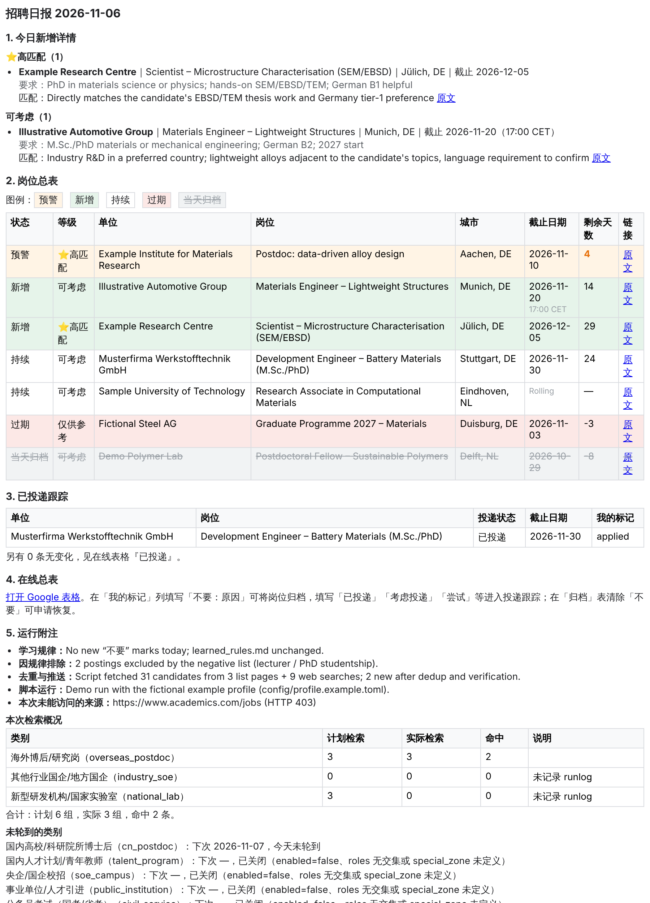
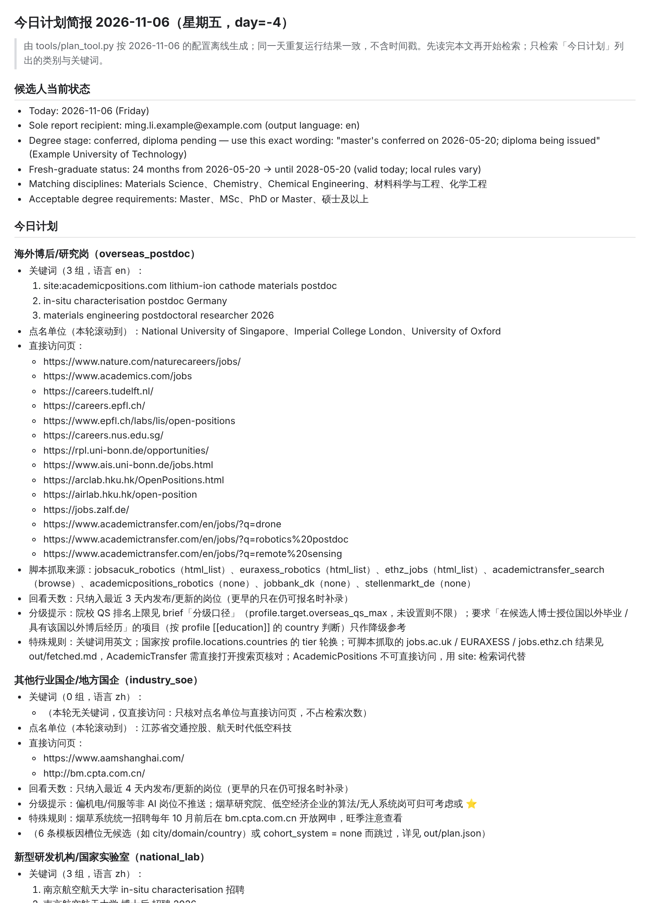

# job-scan · a config-driven daily job scanner

中文说明见 [README.zh.md](README.zh.md)。Architecture notes: [docs/ARCHITECTURE.md](docs/ARCHITECTURE.md) (Chinese).

**job-scan** is a job-hunting assistant driven by a scheduled LLM task (a Claude *Routine*). Every day it searches public job postings according to a plan generated from two TOML files — *who you are* and *where to look* — verifies the original pages, records matches in a master CSV, mirrors them to a Google Sheet, and emails you a report.

It was built by a PhD candidate in AI / robotics looking at postdocs, national labs, state-owned-enterprise campus hiring and civil-service exams in China and Europe. Everything specific to that person lives in `config/profile.toml`; the rest is generic.

<p align="center">
  
  &nbsp;
  
</p>
<p align="center"><sub>Left: the daily report email. Right: the plan brief the Routine reads first. Both generated from the fictional <code>config/profile.example.toml</code>.</sub></p>

## How it works

The design principle: **the LLM judges, scripts compute.**

| Who | Does what |
|---|---|
| **You** | Maintain `config/profile.toml` (who you are, what you want, hard requirements, preferred cities) and `config/sources.toml` (categories, how often, named institutions, list pages). Write `不要：reason` / `已投递` / `考虑投递` in the sheet's "我的标记" column. |
| **Scripts** (`tools/`, Python ≥ 3.11 standard library only) | Daily plan and keyword rotation, candidate status (age limits, degree stage), list-page scraping, status/days-left, dedup, mark merging, email tables and Sheets data, coverage stats. Deterministic and unit-tested. |
| **Routine** (LLM) | Reads `out/brief.md`, searches, opens the original posting to verify major/degree/age/deadline, writes a one-line match reason, sends the email, writes the sheet, commits. |

```
Routine run
  ├─ 0 git checkout main && git pull origin main
  ├─ 1 jobs_tool.py validate                 check jobs.csv (old 16-col header → warning only)
  ├─ 2 plan_tool.py brief                    → out/brief.md, out/plan.json
  ├─ 3 fetch_tool.py                         → out/fetched.md (today's list pages; never blocks)
  ├─ 4 read Sheets → out/sheet_values.json → jobs_tool.py marks --from …   merge your marks
  │      semantic marks (applied / rejected / restore) via jobs_tool.py set
  ├─ 5 jobs_tool.py status                   re-judge every open job by date rules
  ├─ 6 search per brief + verify fetched candidates; check → add; runlog per category
  ├─ 7 jobs_tool.py status && jobs_tool.py report   → summary.html, sheets.json, coverage.md
  ├─ 8 write the sheet, send the email
  └─ 9 jobs_tool.py validate → git commit "scan YYYY-MM-DD" → push main
```

`PROMPT.md` is the Routine's instruction file and contains exactly this table plus the rules; it holds no personal facts.

## Repository layout

| Path | Purpose | Maintained by |
|---|---|---|
| `PROMPT.md` | Routine instructions: workflow, status rules, email/sheet format, safety red lines (Chinese) | you |
| `config/profile.toml` | **The only file with personal data.** Identity, degrees, cohort/age thresholds, research topics and target domains (multilingual term lists), role switches, matching tiers, cities/countries/special zones, résumé paths | you |
| `config/sources.toml` | Scan scope: schedule budget, `[[category]]` entries (frequency, query templates, pinned queries, named institutions, browse pages), `[[source]]` entries (scrapable list pages, pages that need a human, known-dead sites) | you |
| `config/profile.example.toml` | A complete, fictional example with comments | — |
| `learned_rules.md` | Rules the Routine infers from your `不要：reason` marks, plus the mark-semantics table | Routine appends; you may edit |
| `jobs.csv` | Master record, 17 columns (see below) | Routine |
| `dismissed.csv` | Links you never want to see again | you |
| `sources_found.md` | Inbox of newly discovered sources (fixed line format, `sources_tool.py add` only) | Routine appends; you promote into `sources.toml` |
| `sheet_id.txt` | Google Sheet id (written on first run) | Routine |
| `tools/config.py` | Load / default / validate both TOML files; `--check` runs in CI | — |
| `tools/plan_tool.py` | `brief` / `plan` / `schedule` — offline, deterministic | — |
| `tools/profile_tool.py` | `status` / `age-ok` / `keywords` | — |
| `tools/fetch_tool.py` | Config-driven list-page scraper + `selftest` (network; always exit 0) | — |
| `tools/jobs_tool.py` | `validate migrate status check add set marks runlog report` | — |
| `tools/sources_tool.py` | `check add lint` for the sources inbox | — |
| `tests/` | unittest suite + fixtures cut from real pages | — |
| `out/` | Generated artifacts (git-ignored) | scripts |

### `jobs.csv` columns

```
岗位ID, 首次推送日期, 匹配等级, 单位, 岗位, 城市, 链接, 截止日期, 截止说明, 状态, 状态更新日期,
我的标记, 归档日期, 归档原因, 备注, 投递状态, 投递日期
(id, first_pushed, tier, employer, title, city, link, deadline, deadline_note, status, status_updated,
 my_mark, archived_on, archive_reason, notes, application_state, applied_on)
```

- UTF-8, CRLF. `截止日期` is `YYYY-MM-DD` or empty; `截止说明` is free text with a controlled prefix (`需核实` unverified / `长期` open-ended / `Rolling` / `招满即止` until filled / `软截止 YYYY-MM-DD` review-starts date).
- `状态` ∈ 新增 new / 持续 open / 预警 due ≤ 7 days / 过期 expired < 7 days / 归档 archived. `匹配等级` ∈ ⭐高匹配 / 可考虑 / 仅供参考. `投递状态` ∈ empty / 已投递 applied / 进行中 in progress / 进展中 advancing / 已结束 closed.
- Status rules: 7-day warning window, archive 7 days after expiry, archive after 60 days with no deadline (unless marked), archive immediately on a `不要` mark; `进展中` (interview stage) is never auto-archived.

> Column headers, status/tier enums, sheet tab names and email section titles are fixed Chinese strings — they are stable keys shared by the scripts, the sheet and the Routine. `identity.language` controls the candidate-status block in the brief and the prose the Routine writes (match reasons, email body, learned rules). Full localisation is a known limitation; see [Extending](#extending).

## Make it yours (fork guide)

1. **Use the template → create a private repository.** It will hold your résumé and application history.
2. **Edit `config/profile.toml`** (start from `config/profile.example.toml`; every field is commented). Required: `identity.name/email/timezone/language`, at least one `[[education]]`, at least one `[[research.topics]]`, and `locations.cities` or `locations.countries`. Everything else is optional and simply disappears from the brief when omitted (no cohort system, no age limits, a master's as highest degree — all fine).
   - `[[research.topics]]` / `[[target.domains]]` feed the `{topic}` / `{domain}` keyword slots; terms are per language: `terms = { en = ["UAV remote sensing"], de = ["Drohnen-Fernerkundung"] }`.
   - `target.roles` switches categories on and off: a category whose `requires_roles` has no overlap with your roles is silently disabled.
   - Then run `python3 tools/config.py --check` and `python3 tools/profile_tool.py status` and read what the script says about you.
3. **Go through `config/sources.toml`.** It has no identity data, but it was written for the original author's field and region (Chinese universities, SOE campus hiring, civil-service exams, a special zone in Hainan). Set `enabled = false` on categories you don't want, replace `units` with institutions in your field, adjust query templates, and add your own `[[source]]` list pages. Preview with `python3 tools/plan_tool.py brief` and `python3 tools/plan_tool.py schedule --days 14`.
4. **Add your résumé** files at the paths in `[[resumes]]` (Markdown; used only to write match reasons, never sent anywhere).
5. **Set up the Routine.** Create a scheduled task in Claude whose instruction is "follow `PROMPT.md` in the repository". The session needs GitHub access (read/write `main`), a Gmail connector (daily email), and — if `delivery.sheets = true` — Google Sheets/Drive connectors. The sheet named in `delivery.sheet_name` is searched for or created on the first run.
6. **Keep the repository private.** `config/profile.toml`, résumés, `jobs.csv` and `out/` contain personal data. A test scans every tracked file for the values in your profile and fails CI if they leak elsewhere.

## Command cheat sheet

All scripts support `--help`; "today" defaults to the profile time zone and can be overridden with `--today YYYY-MM-DD`.

```bash
python3 tools/config.py --check                       # validate both config files
python3 tools/profile_tool.py status                  # age limits, degree stage, cohort — as the Routine must quote them
python3 tools/profile_tool.py keywords --today D      # preview today's expanded queries per category
python3 tools/plan_tool.py brief [--quiet]            # write out/brief.md + out/plan.json
python3 tools/plan_tool.py schedule --days 14         # two-week calendar
python3 tools/fetch_tool.py                           # scrape today's due list pages (never fails the run)
python3 tools/fetch_tool.py --source ID --no-write    # try one source
python3 tools/fetch_tool.py --offline tests/fixtures/ethz.html --source ethz_jobs
python3 tools/fetch_tool.py selftest                  # are the stable sources still alive?
python3 tools/jobs_tool.py validate | status | migrate
python3 tools/jobs_tool.py check URL --unit U --title T
python3 tools/jobs_tool.py add --unit U --title T --city C --link URL --level ⭐高匹配 --deadline 2026-12-01 --deadline-note "17:00"
python3 tools/jobs_tool.py set URL --apply-state 已投递 | --archive "reason" | --restore
python3 tools/jobs_tool.py marks --from out/sheet_values.json [--dry-run]
python3 tools/jobs_tool.py report                     # summary.html(_compact), sheets.json, coverage.md
python3 tools/sources_tool.py add URL --note "..." --category ID
python3 -m unittest discover -s tests -v
```

## Scheduling and keywords (how the budget stays small)

- `day = today − schedule.epoch`. A category is due when `(day + offset) % every == 0`; `season` raises the frequency in peak months, `active_months` drops it to weekly otherwise; weekends scale `queries_per_turn` by `weekend_factor`; the total is trimmed to `max_queries_per_day` by weight (pinned queries are never cut).
- Each template slot rotates through its candidate list by `(day + template_index) % len(candidates)` — a diagonal walk, not a Cartesian product — so the number of queries is bounded and predictable.
- If `jobs.csv` shows the last run was ≥ 2 days ago, the missed days' categories are folded in (catch-up) and the look-back window is extended.

## Adding a scrapable list page

Add a `[[source]]` with `fetch = "html_list"`, a `link_pattern` for job links and, optionally, `block_pattern`, `date_pattern` + `date_format` (or rely on `<time datetime>` / `date_from_url`), `date_kind` (`deadline | published | range`), `closed_markers`, `title_exclude` (regex for noise such as lecturers, PhD studentships, managers — mind `Post-doctoral`), `title_filter` (`"profile"` uses your topic/domain/role terms). Validate with `fetch_tool.py --source ID --no-write`, then cut a 2–3-item fixture into `tests/fixtures/` and assert on it. Pages that scripts cannot read (JS single-page apps, anti-bot, login) go in as `fetch = "browse"` with an `access_note`; the brief then lists them as "open manually".

## Extending

| Want | Change | Code? |
|---|---|---|
| A new category | `[[category]]` + `requires_roles`; enable the role in the profile | no |
| A new language | `terms = { xx = [...] }`, category `lang = "xx"` (falls back to `en`) | no |
| Different thresholds (warning window, archive delays) | constants at the top of `tools/jobs_tool.py` | constants |
| A new keyword slot | `ALLOWED_SLOTS` in `config.py` + candidate table in `plan_tool.py` | small |
| Another delivery channel | step 8 of `PROMPT.md` + a switch in `[delivery]` | prompt only |
| English headers / enums | add a UI string table in `jobs_tool.py` (`render_*`, `sheets_payload`) and the tab names in `PROMPT.md` | medium |
| Another LLM platform | nothing: any agent that can read the repo, run `python3` and send email can follow `PROMPT.md` | no |

## Privacy and security

No secrets or environment variables are needed; Gmail/Sheets access comes from the Routine's connectors. `fetch_tool.py` only requests URLs declared in `sources.toml`, refuses cross-domain redirects, caps body size before and after decompression, and treats page text as data. Marks read back from the sheet are sanitised (formula prefixes rejected, control characters stripped). Keep the repository private.

## License

MIT — see `LICENSE`.
