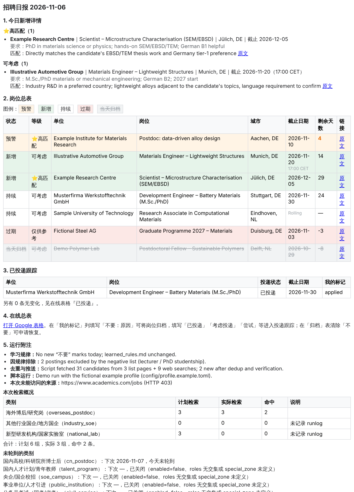
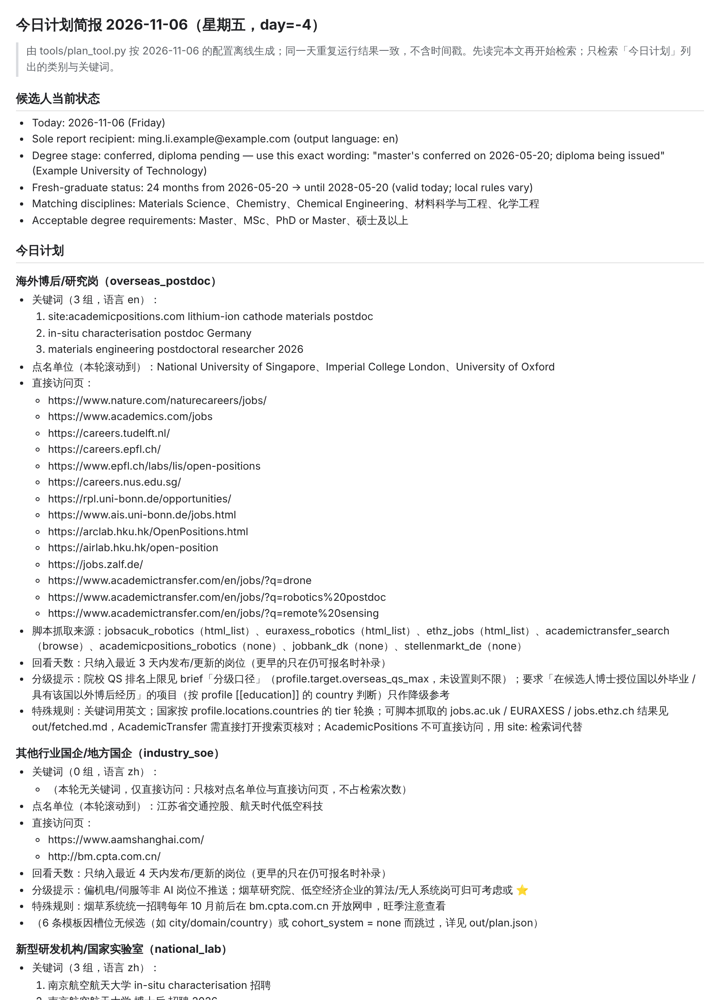

# job-scan · 招聘扫描日报

English: [README.md](README.md) · 架构说明：[docs/ARCHITECTURE.md](docs/ARCHITECTURE.md) · 导出公开模板：`scripts/make_template.sh <目录>`

一个由 **Claude 定时任务（Routine）** 驱动、**配置化**的求职信息助理：每天按 `PROMPT.md` 的流程和 `config/` 中的画像与扫描计划，检索公开招聘信息（海外博后、国内博士后/人才计划、央企国企校招、事业单位、国家实验室、公务员考试、专项区域等，类别可增删），把匹配岗位记入 `jobs.csv`，同步到 Google 表格，并发送 HTML 日报邮件。

<p align="center">
  
  &nbsp;
  
</p>
<p align="center"><sub>左：日报邮件；右：Routine 开工前读的计划简报。均由虚构示例画像 <code>config/profile.example.toml</code> 生成。</sub></p>

分工：

- **人**：维护 `config/profile.toml`（你是谁、要找什么、硬门槛、偏好城市）和 `config/sources.toml`（扫什么、多久扫一次、点名单位、可抓取的列表页），在在线表格「我的标记」列写「不要：原因」「已投递」等。
- **脚本（`tools/`，仅 Python 3.11+ 标准库）**：每天生成计划简报（关键词轮换、候选人年龄/届别/学位阶段措辞、负面清单、预算）、抓取可脚本解析的列表页、算状态和剩余天数、去重、合并标记、生成邮件表格与 Sheets 数据、统计检索覆盖情况。
- **Routine（LLM）**：读 `out/brief.md`，做检索与原文核实，写匹配理由，发邮件、写表格、提交。

## 每日流程

```
Routine 触发
  ├─ 0 git checkout main && git pull origin main
  ├─ 1 jobs_tool.py validate                  校验 jobs.csv（旧 16 列表头只警告）
  ├─ 2 plan_tool.py brief                     → out/brief.md、out/plan.json（候选人状态、今日计划、负面清单、预算）
  ├─ 3 fetch_tool.py                          → out/fetched.md、out/fetched.json（今天轮到的列表页；失败不阻断）
  ├─ 4 读 Sheets → out/sheet_values.json → jobs_tool.py marks --from …   合并「我的标记」
  │      按 learned_rules.md 的语义用 jobs_tool.py set 落地（投递状态、按原因归档、待恢复 → set --restore）
  ├─ 5 jobs_tool.py status                    按日期规则重新判定状态
  ├─ 6 按 brief 逐类检索 + 核实 fetched 候选
  │      每条 jobs_tool.py check → add；每类完成后 jobs_tool.py runlog
  ├─ 7 jobs_tool.py status && jobs_tool.py report   → summary.html/txt、sheets.json、coverage.md
  ├─ 8 写表格、发邮件（检索概况用 out/coverage.md）
  └─ 9 jobs_tool.py validate → git commit「scan YYYY-MM-DD」→ push main
```

推送到 main 后，GitHub Actions（`.github/workflows/validate.yml`）会校验两份配置、`jobs.csv`、`sources_found.md`，离线生成一次 brief，并跑单元测试。

## 文件说明

| 文件 | 作用 | 由谁维护 |
|---|---|---|
| `PROMPT.md` | Routine 的执行指令：流程、状态规则、邮件与表格格式、安全红线（不含个人事实与类别清单） | 本人 |
| `config/profile.toml` | ★ 候选人画像：身份、教育、届别/年龄门槛、研究主题、目标方向与岗位类型、分级口径、城市/国家、简历、标记前缀。**唯一含个人信息的配置** | 本人 |
| `config/profile.example.toml` | 虚构人物的完整示例，每个字段带注释与「省略写法」；CI 用它跑校验 | — |
| `config/sources.toml` | 扫描类别（频率、关键词模板、点名单位、直接访问页、特殊规则）与可抓取的列表页 `[[source]]`；文件顶部有频率设计表 | 本人 |
| `learned_rules.md` | 从「我的标记」归纳的规律（brief 的负面清单来源），以及各类标记的处理规则 | Routine 追加，本人可改 |
| `jobs.csv` | 岗位主记录（17 列，见下） | Routine |
| `dismissed.csv` | 不感兴趣的岗位链接（单列「链接」） | 本人 |
| `sources_found.md` | 待人工核实的新来源收件箱，固定行格式，只能用 `sources_tool.py add` 追加 | Routine 追加，本人定期并入 `sources.toml` |
| `sheet_id.txt` | 在线总表（Google Sheets）的 ID | Routine |
| `resume_zh.md` / `resume_en.md` | 简历（路径在 profile `[[resumes]]` 中声明），仅用于评估匹配度，不对外发送 | 本人 |
| `tools/config.py` | 读取/校验两份 TOML，被其他脚本 import；`--check` 进 CI | — |
| `tools/jobs_tool.py` | jobs.csv 工具：validate / migrate / status / check / add / set / marks / runlog / report | — |
| `tools/profile_tool.py` | 候选人状态：status / age-ok / keywords | — |
| `tools/plan_tool.py` | 每日计划：brief / plan / schedule（离线、确定性） | — |
| `tools/fetch_tool.py` | 配置驱动的列表页抓取（联网；永远 exit 0）+ selftest | — |
| `tools/sources_tool.py` | sources_found.md 的 check / add / lint | — |
| `tests/` | 单元测试与真实页面裁剪的 `fixtures/*.html` | — |
| `out/` | 机器产物（brief.md、plan.json、fetched.md/json、runlog.json、summary.html/txt、sheets.json、coverage.md、sheet_values.json），已 gitignore，不提交 | 脚本 |

### jobs.csv 列（17 列）

`岗位ID, 首次推送日期, 匹配等级, 单位, 岗位, 城市, 链接, 截止日期, 截止说明, 状态, 状态更新日期, 我的标记, 归档日期, 归档原因, 备注, 投递状态, 投递日期`

- 文件为 UTF-8、CRLF 换行；含英文逗号的字段必须加引号（用 `add` 命令追加可自动处理）。
- `截止日期` 只允许 `YYYY-MM-DD` 或空（空 = 不详）。`截止说明` 为自由文本，受控前缀：`需核实` / `长期` / `Rolling` / `招满即止` / `软截止 YYYY-MM-DD`，后接「；」和余文，例如「需核实；原文未写；2026-10-29发布」「软截止 2026-10-19；开始审阅，招满为止」「17:00」。软截止不参与过期判定。
- 旧版 16 列文件（`截止日期` 中混有「需核实（…）」「Rolling」等）读取时在内存中自动升级并拆分，下一次写入即完成迁移；`validate` 对旧表头只警告（`--strict` 才算错误）。
- `状态` ∈ 新增 / 持续 / 预警 / 过期 / 归档；`匹配等级` ∈ ⭐高匹配 / 可考虑 / 仅供参考；`投递状态` ∈ 空 / 已投递 / 进行中 / 进展中 / 已结束。

## 换成你自己（Fork 指南）

1. **Fork 为私有仓库**（含简历与个人信息，见「隐私」）。
2. **必改 `config/profile.toml`**。建议从 `config/profile.example.toml` 复制后逐项修改，每个字段的含义与可否省略都写在示例的注释里。字段速览（★ 必填）：

   | 节 | 字段 | 说明 |
   |---|---|---|
   | `[identity]` | `name`★ `name_en` `email`★ `timezone`★ `language`★ `birth_month` | 日报唯一收件地址；IANA 时区决定脚本的「今天」；`language` 决定 brief「候选人当前状态」的措辞语言，以及 Routine 自己撰写的文字（今日新增详情、匹配理由、learned_rules.md 条目）的语言——`report` 生成的岗位总表表头/图例/工作表名与 jobs.csv 的状态、等级、投递状态枚举值固定为中文（它们是脚本与表格读回的稳定键）；`birth_month` 为 TOML 日期（只到月，按当月 1 日保守算年龄），省略则 brief 不提示年龄 |
   | `[delivery]` | `email` `sheets` `sheet_name` `legacy_history_sheets` | 是否发邮件 / 同步 Sheets；表格名；是否把同一表格里其他任务维护的旧工作表作为只读去重来源 |
   | `[[education]]` | `level`★ `institution`★ `institution_en` `country` `qs_rank` `field` `discipline_codes` `period` `defense_date` `conferral_date` `diploma_received` `topics` `note` | 按学位从高到低；最高学位的 `defense_date` / `conferral_date` / `diploma_received` 决定 brief 中「学位阶段」措辞 |
   | `[status]` | `cohort_system`（cn\|none，默认 none）`cohort_year` `overseas_returnee` `fresh_grad_grace_months` `age_thresholds` `degree_years_thresholds` | 届别体系与届别（cn 时可按授位日推算：7 月及以后 → 次年）；留学归国应届宽限月数；常见年龄上限列表；「获博士学位 N 年内」门槛 |
   | `[research]` | `summary` `disciplines` `skills`；`[[research.topics]]`★：`id` `weight` `terms` | `disciplines` 是公告「专业要求」可对口的学科；`topics` 填关键词槽位 `{topic}`，`terms = { zh = […], en = […] }`，weight 越大越先轮到 |
   | `[[target.domains]]` | `id` `weight` `terms` | 想去的方向，只用于关键词槽位 `{domain}`；⭐ 判定以 `[matching].high` 为准 |
   | `[target]` | `roles` `role_terms` `orientation` `avoid` `degree_requirements_ok` `hard_requirements` `overseas_qs_max` | `roles` 与 `sources.toml` 各类别的 `requires_roles` 取交集，无交集的类别自动关闭（已知 role：postdoc national_lab talent_program soe_campus industry_rd public_institution civil_service）；`role_terms` 填槽位 `{role}`；`overseas_qs_max` 是独立于 learned_rules.md 的硬配置，放宽/取消时改这里（删掉即不按排名过滤） |
   | `[matching]` | `high` `consider` `reference` | 分级口径三档文字，brief 原样呈现 |
   | `[locations]` | `cities`（★ 或 countries 至少其一）`top_cities` `provinces`；`[[locations.countries]]`：`name` `tier`；`[[locations.special_zones]]`：`id` `name` `city` `note` | 顺序即偏好；`{city}` 只展开前 `top_cities` 个；专项区域方向对口即 ⭐，`sources.toml` 中类别用 `special_zone = "<id>"` 引用 |
   | `[[resumes]]` | `lang` `path` `use_for` | 简历路径与适用范围 |
   | `[marks]` | `dismiss_prefixes` | 「我的标记」以这些词开头视为不感兴趣，默认 `["不要"]` |

   改完运行 `python3 tools/config.py --check`，错误为 0 即可；再用 `python3 tools/profile_tool.py status` 看脚本给出的年龄门槛、学位阶段、届别措辞是否符合预期。
3. **选改 `config/sources.toml`**（不含姓名/邮箱/学校等身份信息，可直接用；但它是原作者的扫描范围模板：类别、点名单位 `units`、直接访问页 `browse`、关键词模板中含具体地名/方向的条目（如公务员类写死的省考与省人事考试网）都按原作者的学科与地域写的，fork 后请逐类过一遍，用不到的类别设 `enabled = false`，并用 `python3 tools/profile_tool.py keywords --today YYYY-MM-DD` 预览展开结果）：
   - 只找海外岗位：把 `cn_postdoc` / `talent_program` / `soe_campus` / `industry_soe` / `public_institution` / `national_lab` / `civil_service` / `special_zone_yazhouwan` 的 `enabled` 都设为 `false`（仅靠 `target.roles` 关不掉 `cn_postdoc`、`national_lab`、`industry_soe`，它们的 `requires_roles` 含 postdoc / industry_rd），只保留 `overseas_postdoc`，再把 `[[source]]` 中 `category` 不是 `overseas_postdoc` 的来源删掉或保留不管（未轮到的类别不会抓取）。
   - 关掉某个类别：从 profile `target.roles` 中删掉对应 role，或把该 `[[category]]` 的 `enabled = false`；引用了 profile 中不存在的 `special_zone` 的类别也会自动关闭（`--check` 会给警告）。
   - 改频率：每类的 `every`（每 N 天一轮）、`offset`（错开日）、`weekdays`、`season = { months = […], every = … }`（旺季覆盖）、`active_months`（淡季降为每 7 天）、`queries_per_turn`（每轮关键词组数）、`weight`（超预算时先砍 weight 低的）；全局 `[schedule]` 见下节「频率与预算」。改完用 `python3 tools/plan_tool.py schedule --days 14` 看两周日历。
   - 改关键词：`query_templates` 中的槽位只允许 `{topic} {domain} {role} {city} {province} {country} {unit} {zone} {year} {year_next} {cohort} {degree}`；槽位无候选的模板会整条跳过；`pinned` 为每轮必查的固定词；`units` 为点名单位（槽位 `{unit}` 按窗口滚动）；`browse` 为 Routine 直接打开的页面。用 `python3 tools/profile_tool.py keywords --today YYYY-MM-DD` 预览展开结果。
   - 加一个可抓取的列表页：新增一个 `[[source]]`，字段含义——`category`（所属类别 id）、`url` / `pages`（附加页）、`every`（按类别轮次计）、`fetch`（`html_list` 脚本抓取 / `browse` 人工打开 / `none` 仅记录）、`link_pattern`（岗位链接 href 正则，相对或绝对均可）、`block_pattern`（按 class/id 切块，日期只在块内找；无块时取锚点前后 300 字）、`time_attr`（优先取块内 `<time datetime>`）、`date_pattern` + `date_format`（strptime；无年份时截止类取就近未来（≤14 天前视为刚截止而不推到一年后，会被过期过滤）、发布类取就近过去并标 inferred）、`date_kind`（deadline / published / range，range 取右端）、`date_from_url`（命名组 y m d）、`closed_markers`（块内出现即跳过）、`title_filter`（`"profile"` 用画像的 topics/domains/role_terms 过滤标题 / 正则 / `""` 不过滤）、`title_exclude`（标题排除正则，先于 title_filter 生效，用来剔除讲师/教授编制岗、PhD 奖学金、经理等噪音；写法注意不要误伤 Post-doctoral，如 `(?<!Post-)(?<!Post)Doctoral`）、`access_note`（仅 `fetch = browse/none` 用：说明为什么脚本打不开——JS 单页应用、反爬、云端 503 等；brief 的「直接访问页」会标注「需人工打开：…」，Routine 打不开时改用搜索引擎的官方转载并在邮件中列为未能访问）、`max_age_days`（published 类只保留 N 天内）、`status`（stable / experimental）。验证：`python3 tools/fetch_tool.py --source 新id --no-write`；稳定后把页面裁剪成 `tests/fixtures/*.html`（2–3 个条目，≤40KB，去掉 script），在 `tests/test_fetch_tool.py` 中加断言，并用 `python3 tools/fetch_tool.py --offline tests/fixtures/x.html --source 新id` 离线复核。
4. **替换简历**：按 profile `[[resumes]]` 中的路径放入你的简历文件（Markdown）。
5. **清空历史数据**：`jobs.csv` 只保留表头行（17 列，见上）；`dismissed.csv` 只保留表头「链接」；`sources_found.md` 只保留标题与说明段；删除 `sheet_id.txt`（首次运行会按 `delivery.sheet_name` 搜索或新建表格并写回）；`learned_rules.md` 删掉规律条目，保留「我的标记含义与处理规则」表格。
6. **设置 Routine**：在 Claude 中新建定时任务，指令为「按仓库 `PROMPT.md` 执行」，会话需要 GitHub 访问（读写本仓库 main 分支）、Gmail 连接器（发日报）以及 Google Sheets / Drive 连接器（`delivery.sheets = true` 时）。建议每天固定时刻运行一次；`PROMPT.md` 的步骤表就是 Routine 每天要走的流程。
7. **隐私**：保持私有仓库；`config/profile.toml`、简历、`jobs.csv`、`out/` 都含个人信息，不要公开或粘贴到公共位置；除 `config/profile.toml`、简历和历史数据文件外，仓库中其他任何文件都不应出现个人事实（`tests/test_config.py` 会按 profile 中的姓名、邮箱、出生月、学校逐个检查 `git ls-files` 列出的文件，失败时只报文件名不回显内容）。

## 频率与预算

`config/sources.toml` 的 `[schedule]`：

| 字段 | 含义 |
|---|---|
| `epoch` | 轮换基准日；`day = (今天 − epoch).days`，不要随意改动，否则各类错开日整体平移 |
| `max_queries_per_day` | 每天检索组数软上限（含固定检索）。超过时 plan_tool 逐个减 1：weight 最低 → 当前组数最多 → 配置靠后，固定检索（pinned）永不砍，每类至少保留 1 组 |
| `min_queries_per_day` | brief 中写给 Routine 的「合计不少于」 |
| `weekend_factor` | 周六日每类 `queries_per_turn` 乘以此系数（向上取整，至少 1） |
| `fetch_timeout_sec` / `fetch_total_sec` / `fetch_max_items_per_source` | fetch_tool 的单页超时、整轮上限、每源最多候选数 |

调度口径：类别在 `enabled` 且 roles 有交集 且 `(day + offset) % every_eff == 0` 且（`weekdays` 省略或当天在其中）时轮到；`every_eff` = `season.every`（当月在 `season.months`）否则 7（当月不在 `active_months`）否则 `every`。关键词按 `turn = day // every_eff` 轮换模板起点，每个槽位按 `(day + 模板序号) % 候选数` 对角轮询，同一天重复运行结果完全一致。若 jobs.csv 的最大「状态更新日期」距今天 ≥ 2 天，brief 自动把漏掉日子轮到的类别并入（补跑），并延长回看天数。

`python3 tools/plan_tool.py schedule --days 14 --today 2026-11-05` 的示例输出（真实配置）：

```
两周日历（自 2026-11-05 起 14 天；epoch 2026-11-10；格式：类别id×关键词数，含固定检索）
2026-11-05 星期四 day= -5 | 合计 14 | cn_postdoc×3, talent_program×2, soe_campus×3, public_institution×2, civil_service×4
2026-11-06 星期五 day= -4 | 合计 15 | overseas_postdoc×3, soe_campus×3, industry_soe×1, national_lab×2, civil_service×3, special_zone_yazhouwan×3
2026-11-07 星期六 day= -3 | 合计  8 | cn_postdoc×2, soe_campus×2, public_institution×1, civil_service×3
2026-11-08 星期日 day= -2 | 合计 14 | overseas_postdoc×2, talent_program×1, soe_campus×2, national_lab×2, civil_service×3, special_zone_yazhouwan×4
2026-11-09 星期一 day= -1 | 合计 14 | cn_postdoc×3, soe_campus×3, industry_soe×2, public_institution×2, civil_service×4
2026-11-10 星期二 day=  0 | 合计 15 | overseas_postdoc×3, soe_campus×3, national_lab×3, civil_service×3, special_zone_yazhouwan×3
2026-11-11 星期三 day=  1 | 合计 14 | cn_postdoc×3, talent_program×2, soe_campus×3, public_institution×2, civil_service×4
…
```

各类别的 every/offset/每轮组数与理由见 `config/sources.toml` 文件顶部的频率设计表（表中「每轮组数」为模板展开数 + 固定检索数 `pinned`；pinned 不计入 `queries_per_turn`，但计入每天总数与 `max_queries_per_day` 的裁剪比较，且永不被砍）。

## 迁移与合并说明（从 16 列升级到 17 列）

- 本次改造的 PR **不修改 `jobs.csv`**：Routine 每天把全部未归档行的「状态更新日期」改成当天并提交到 main，任何对 jobs.csv 的改动都会逐行冲突。
- 合并后第一次写入 jobs.csv 的命令（`status` / `add` / `marks` / `migrate`）会自动把文件升级为 17 列：插入「截止说明」列，并把旧「截止日期」中的非 ISO 文字（需核实、长期、Rolling、括号说明、软截止）拆分到新列。升级前后的差异可先用 `python3 tools/jobs_tool.py migrate --dry-run` 查看，`migrate` 幂等。
- 建议避开 Routine 运行窗口（约 07:30–08:30 UTC）合并；合并后可立即手动执行 `python3 tools/jobs_tool.py migrate && python3 tools/jobs_tool.py validate` 并推 main，让当天 Routine 的 diff 保持干净，或者直接等下次 Routine 写入时自动完成。
- `pushed.csv`（旧版推送记录）已删除，其全部记录早已在 `jobs.csv` 中；历史可在 git 中查看。

## 命令速查

所有脚本都支持 `--help`；「今天」默认取 profile `identity.timezone` 的当天，可用 `--today YYYY-MM-DD` 覆盖（用于补跑或预演；`jobs_tool` / `profile_tool` / `plan_tool` 的 `--today`、`--profile` 等公共选项放在子命令前后均可）。错误信息为中文。

```bash
# 配置
python3 tools/config.py --check                                     # 校验两份配置（错误 → 退出 1）
python3 tools/config.py --check --profile config/profile.example.toml
python3 tools/config.py --dump                                      # 打印补全默认值后的配置 JSON

# 候选人状态（离线）
python3 tools/profile_tool.py status [--today D]                    # Markdown 块「候选人当前状态」
python3 tools/profile_tool.py age-ok --born-after 1990-11-01        # 退出码 0 满足 / 1 不满足 / 2 无法判断
python3 tools/profile_tool.py keywords [--today D] [--category ID]  # 预览当天各类别展开的关键词

# 每日计划（离线、确定性）
python3 tools/plan_tool.py brief [--today D] [--out out] [--no-catch-up] [--quiet]   # 写 out/plan.json + out/brief.md 并打印（--quiet 只写不打印，CI 用）
python3 tools/plan_tool.py plan  [--today D] [--out out]                   # 只写 out/plan.json
python3 tools/plan_tool.py schedule --days 14 [--today D]                  # 两周日历

# 列表页抓取（联网；永远 exit 0）
python3 tools/fetch_tool.py                                         # 按 out/plan.json 今天轮到的类别
python3 tools/fetch_tool.py --all                                   # 全部 html_list 来源
python3 tools/fetch_tool.py --source ethz_jobs --no-write           # 只抓一个来源并打印；不加 --no-write 则把该来源结果合并进当天的 fetched.md/json（不覆盖其他来源）
python3 tools/fetch_tool.py --offline tests/fixtures/ethz.html --source ethz_jobs   # 本地 HTML 解析
python3 tools/fetch_tool.py selftest [--source ID]                  # stable 来源自检（联网，不进 CI）

# jobs.csv
python3 tools/jobs_tool.py validate [--strict]                      # 校验（旧表头只警告）
python3 tools/jobs_tool.py migrate [--dry-run]                      # 16 列 → 17 列，幂等
python3 tools/jobs_tool.py status [--dry-run]                       # 重新判定未归档岗位状态
python3 tools/jobs_tool.py check "https://example.com/job/123" --unit "单位" --title "岗位"   # 去重（疑似重复 → 退出 2）
python3 tools/jobs_tool.py add --unit "单位" --title "岗位" --city "南京" --link "https://..." \
        --level "⭐高匹配" --deadline 2026-12-01 --deadline-note "17:00" --note "备注"
python3 tools/jobs_tool.py set <链接> [--unit 单位 --title 岗位] [--mark 文字] [--apply-state 已投递|进行中|进展中|已结束] \
        [--apply-date YYYY-MM-DD] [--append-note 文字] [--archive 原因] [--restore] [--dry-run]   # 改一条已有岗位：标记/投递状态/备注/归档/从归档恢复（仅限未过期，之后运行 status）
python3 tools/jobs_tool.py marks --from out/sheet_values.json [--dry-run] [--allow-clear]   # 合并在线表格的「我的标记」；输出含「待恢复（N 条）」「已拒收（N 条，需人工核对）」
python3 tools/jobs_tool.py runlog --category cn_postdoc --searches 3 --hits 1 [--failed URL …] [--note …]
python3 tools/jobs_tool.py report [--out out]                       # summary.html/txt、sheets.json、coverage.md；体积超限时另生成 summary_compact.html 并提示

# 新来源收件箱
python3 tools/sources_tool.py check URL                             # 0 新 / 2 已有
python3 tools/sources_tool.py add URL --note "一句说明" [--category ID] [--today D]
python3 tools/sources_tool.py lint                                  # 进 CI

# 测试
python3 -m unittest discover -s tests -v
```

`report` 在 `out/` 生成：`summary.html`（邮件「岗位总表」，图例 + 表格，全内联样式；截止单元格 = 日期 + 灰色小字截止说明）、`summary.txt`（纯文本版）、`sheets.json`（三个工作表的表头、行、底色、删除线、需加粗橙色的剩余天数、链接列网址，以及 `mark_column` / `deadline_note_column` 等列索引）、`coverage.md`（存在 `out/plan.json` 或 `out/runlog.json` 时：按类别列出计划/实际检索数、命中、未轮到的类别与下次日期、未能访问的来源）。`summary.html` 超过约 90 KB（Gmail 约 102 KB 起裁剪正文）时，`report` 会额外写 `summary_compact.html` 并在输出中提示：持续类只给一行计数并指向在线表格「岗位总表」，预警/新增/过期/当天归档照常详列，此时邮件 htmlBody 用精简版。

## 环境变量与密钥

本仓库不需要任何环境变量或密钥。Gmail、Google Sheets / Drive 的访问由 Routine 所在会话的连接器（Connector）提供，不写入仓库。`fetch_tool.py` 走系统代理（urllib 读取 `HTTPS_PROXY`）并用系统 CA 校验 TLS；若环境提供 `SSL_CERT_FILE` 或 `REQUESTS_CA_BUNDLE`，会优先用它们作为 CA 包。脚本只请求 `config/sources.toml` 中声明的 URL，不跟随跨域重定向。

## 隐私

仓库包含简历和个人信息，请保持为**私有仓库**。个人信息只应出现在 `config/profile.toml`、简历和 `jobs.csv` / `sources_found.md` 的历史数据中；`PROMPT.md` 已规定简历内容不得发送给任何第三方、邮件只发给 profile 指定的地址。
